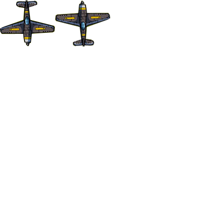

# SkyForce

The starting framework for a 2D Java Swing game, written as an undergraduate Java project.

**Status: early prototype.** The code sets up the game window and main loop but does not yet contain gameplay. The planned game, a ball that the player keeps from falling into a bucket, was not implemented.

## What is implemented

- `Display`: a `JFrame` holding an AWT `Canvas`
- `GameSetup`: a `Runnable` game loop on its own thread with a fixed 50 ticks per second, separate `tick()` and `render()` steps, and triple buffering through `BufferStrategy`
- `GameManager` and `Players`: placeholder classes for game state and player position



## Running

Open the `SkyForce/` folder in IntelliJ IDEA and run `SkyForce.Main`, or from the command line:

```bash
cd SkyForce/src
javac SkyForce/*.java
java SkyForce.Main
```

## Author

**S M Mahamudul Hasan** · [GitHub](https://github.com/hasansust32)
